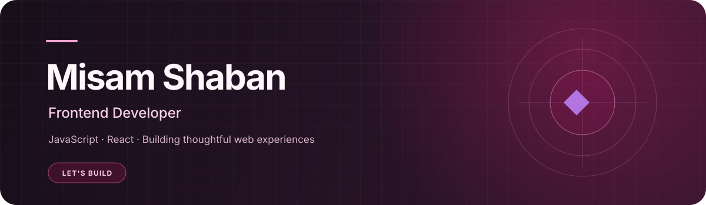
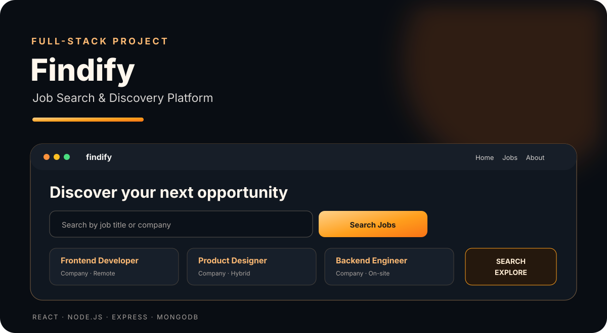
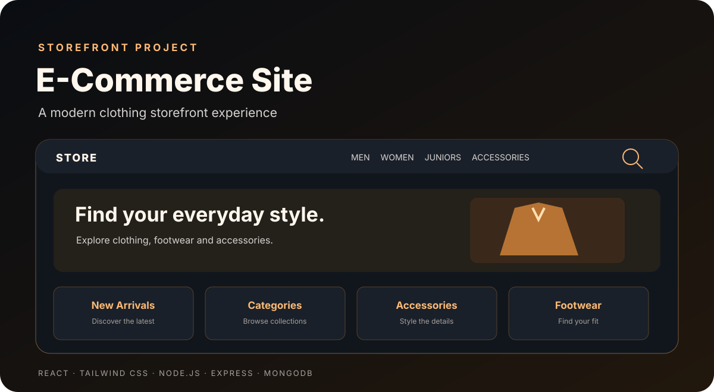
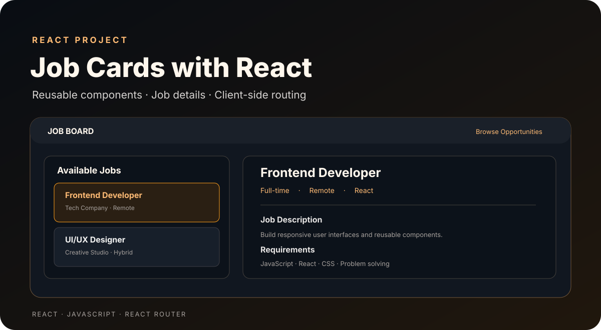
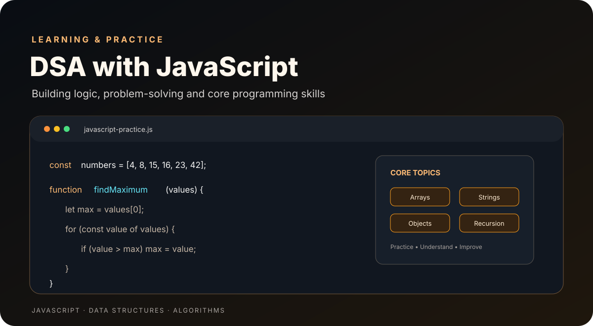

<!-- ORANGE / AMBER PROFILE THEME -->

 

---

## About Me

I'm a **Full-Stack Developer** who enjoys building complete web experiences — from responsive interfaces to backend APIs and database-driven features.

- Building frontend experiences with **React, JavaScript, and Tailwind CSS**.
- Developing backend services with **Node.js, Express.js, and MongoDB**.
- Working with REST APIs, CRUD operations, and full-stack application workflows.
- Practicing **Data Structures & Algorithms with JavaScript**.
- Exploring **Generative AI, AI agents, and LangChain**, with a focus on building a chat support agent.

## Tech Stack

**Frontend**

**Backend & Database**

**Tools**

**Currently Exploring:** Generative AI · LLMs · AI Agents · LangChain · LangGraph

## Featured Projects

  Visual project previews · Orange, amber and charcoal theme

<table>
  <tr>
    <td width="50%" valign="top">
      
      <h3>Findify — Job Search Platform</h3>
      
A full-stack job discovery app with keyword and location search, job details, and job management features.

      
React · Vite · Tailwind CSS · Node.js · Express · MongoDB

      
    </td>
    <td width="50%" valign="top">
      
      <h3>E-Commerce Site</h3>
      
A clothing storefront project with a dark-themed React UI and a backend foundation for user registration.

      
React · Tailwind CSS · Node.js · Express · MongoDB

      
    </td>
  </tr>
  <tr>
    <td width="50%" valign="top">
      
      <h3>Job Cards with React</h3>
      
A job-listing interface with reusable React components, detailed job pages, and client-side routing.

      
React · JavaScript · React Router

      
    </td>
    <td width="50%" valign="top">
      
      <h3>DSA with JavaScript</h3>
      
A practice repository for strengthening problem-solving skills and understanding core data structures and algorithms.

      
JavaScript · Data Structures · Algorithms

      
    </td>
  </tr>
</table>

## GitHub Activity

  
  

  

## Contribution Snake

  

## Let's Connect

  
  
    
  Building, learning, and improving — one project at a time.

